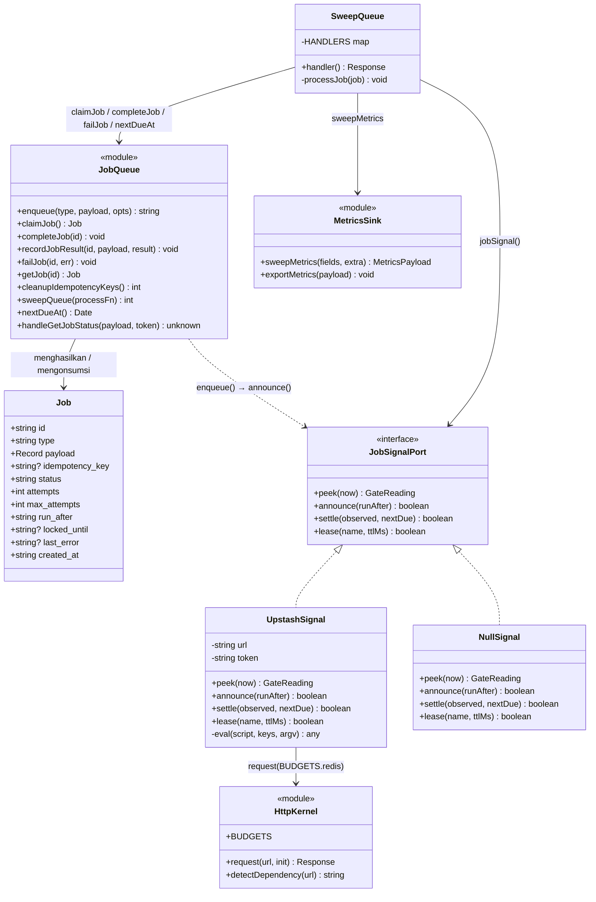
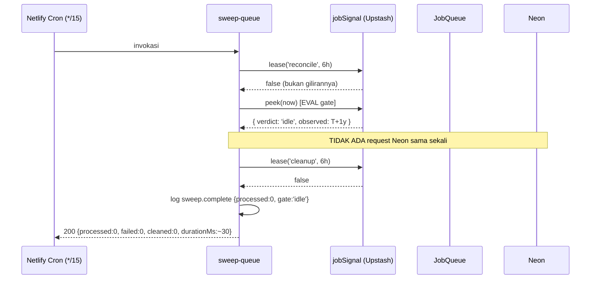
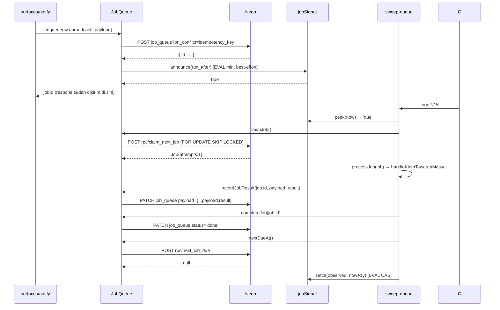
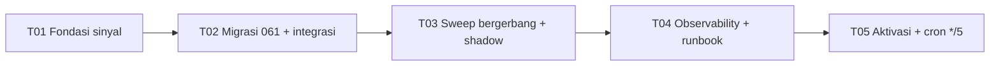

# Rencana: Sweep Antrean Job Tanpa Neon

**Status:** diimplementasi (commit `22453fae`). Migrasi `061_next_job_due.sql`
**sudah diterapkan** ke produksi 2026-11-20T13:30:46Z (61/61, 0 drifted) dan
`verify:db` melaporkan `fn next_job_due required OK`. Gerbang masih **dorman**
karena `JOB_SIGNAL_MODE` default `off` dan Upstash belum diprovision — lihat
`docs/RUNBOOK_ANTREAN_TANPA_NEON.md`.
**Tanggal:** 2026-11-20
**Ruang lingkup:** `netlify/functions/sweep-queue.ts` + `_lib/kernel/job-queue.ts`
**Di luar lingkup:** `agenda-reminders.ts` (lihat §11.1 — tidak bisa dipindah)

---

## 0. Keputusan dalam satu paragraf

**Tier A** — Neon tetap menjadi ledger, dan sweep mendapat *gerbang* murah di Upstash Redis yang
dibaca sebelum satu pun request Neon dikirim. Gerbang itu bukan salinan antrean, melainkan **satu
kunci skalar berisi instant-berikutnya-antrean-perlu-dilihat** (varian A′, lihat §3.2), dihitung
dari `next_job_due()` — RPC baru yang memakai predikat `WHERE` yang **sama persis** dengan
`claim_next_job()`. Sweep kosong menjadi 2 perintah Redis (~10–40 ms) dan **nol** request Neon.
Kontrak `attempts` / dead-letter / idempotency **tidak berubah satu byte pun**, karena baris
`job_queue` tetap satu-satunya kebenaran dan `claim_next_job()` tidak disentuh. Satu-satunya operasi
yang **memburuk** adalah `enqueue()` di jalur request: **+5–20 ms p50, +25 ms p95** (satu `EVAL`).

---

## 1. Temuan terukur di repo yang mengubah desain

Ini bukan asumsi — masing-masing dibaca dari kode hari ini, dan tiga di antaranya membatalkan
bentuk desain yang "jelas".

### T1 — `claim_next_job()` tidak pernah menulis `status='dead'`

`migrations/031_claim_next_job_ambiguity.sql:38-46` memfilter, bukan mempromosikan:

```sql
WHERE q.status IN ('pending','failed')
  AND (q.run_after <= NOW() OR q.status = 'failed')
  AND (q.status != 'failed' OR q.attempts < q.max_attempts)
```

Job yang kehabisan percobaan **berhenti di-claim** tetapi statusnya tetap `'failed'`. Komentar di
`job-queue.ts:169` ("The claim function handles dead-letter logic on next claim attempt") dan
`job-queue.ts:14` ("after max_attempts, status → 'dead'") tidak sesuai dengan SQL-nya, dan
`idx_job_queue_dead` (`005_job_queue.sql:32`) mencocokkan 0 baris selamanya.

**Konsekuensi desain:** dead-letter hari ini = *pengecualian*, bukan transisi status. Tier A
mempertahankannya apa adanya. Tier B (Lua) dan Tier C (QStash) **wajib mengimplementasikannya ulang**
dan akan mengubah apa yang dibaca UI: hari ini `getJobStatus` mengembalikan
`status:'failed', attempts:5, maxAttempts:5, hasError:true`; implementasi ulang yang "benar" akan
mengembalikan `status:'dead'`. Itu perubahan perilaku yang terlihat pengguna.

### T2 — Setiap dependency call >100 ms **menulis ke Neon**

`_lib/kernel/http.ts:198-200`:

```ts
if (durationMs > 100 || Math.random() < 0.05) {
  if (!url.includes('/dependency_calls')) void logDependencyCall(...);
}
```

`logDependencyCall` menulis ke tabel `dependency_calls` lewat PostgREST. Hanya `dep === 'postgrest'`
yang dilewati (untuk memutus rekursi). Upstash yang tidak dikenali akan jatuh ke `'other'`
(`http.ts:266`) → **setiap panggilan Redis >100 ms akan membangunkan Neon dan menulis satu baris**,
yang membatalkan seluruh tujuan desain ini.

**Konsekuensi desain:** `detectDependency()` wajib mendapat cabang `upstash`, **dan** panggilan Redis
wajib dikecualikan dari `logDependencyCall`. Ini pekerjaan wajib, bukan penyempurnaan.

### T3 — Bulkhead bersifat global-8 per dependency

`_lib/kernel/resilience.ts:436` — `new Bulkhead(8)`, counter per `dep`. Komentar `http.ts:254-256`
mendokumentasikan kegagalan nyata 2026-10-21: dependency yang salah-label memakan slot `'other'` dan
permintaan biasa mati dengan "Bulkhead limit reached for other". Redis yang lambat, salah-label,
akan mengulang insiden itu.

**Konsekuensi desain:** label `upstash` memberi Redis 8 slot sendiri. Itu **wajib**, bukan opsional.

### T4 — `idempotency_keys` masih dipakai, jadi cleanup tidak boleh dihapus

`_lib/handlers.ts:374` (GET) dan `:400` (POST) masih membaca/menulis tabel itu untuk idempotensi
request. `cleanupIdempotencyKeys()` bukan sisa mati — ia yang menjaga retensi 24 jam.

**Konsekuensi desain:** cleanup **dijadwalkan ulang**, bukan dihapus. Lihat §7 (satu delta semantik
yang dibatasi dan harus diakui).

### T5 — Indeks untuk pembacaan recompute sudah ada

`005_job_queue.sql:23-25`:

```sql
CREATE INDEX idx_job_queue_pending ON job_queue(status, run_after)
WHERE status IN ('pending','failed');
```

**Konsekuensi desain:** recompute tidak butuh indeks baru. Satu-satunya DDL yang dibutuhkan adalah
satu fungsi SQL (§4.3).

### T6 — I/O keluar wajib lewat `kernel/http.ts`

`scripts/ci/io-boundary.mjs:52` — hanya `kernel/http.ts` yang boleh memanggil `fetch`. Gate gagal
pada bypass baru.

**Konsekuensi desain (menguntungkan):** klien Redis otomatis mendapat deadline-clamping, circuit
breaker, bulkhead, dan `dependency.call.latency{dep=upstash}` gratis. Tidak perlu paket
`@upstash/redis`; REST Upstash adalah HTTP biasa. Sekaligus inilah yang membuat T2 wajib
diselesaikan di file yang sama.

### T7 — Env var punya tiga gerbang, bukan satu

`_lib/env.ts:8` (`WHITELIST`), `scripts/ci/verify-env.mjs:40-70` (registry per environment), dan
`netlify/functions/_lib/kernel/../env.ts` yang membaca `.env.local` untuk sandbox. Env var baru yang
tidak terdaftar di ketiganya akan lolos secara lokal dan gagal di produksi.

### T8 — `runAfter` tidak punya pemanggil

Satu-satunya kemunculan `runAfter` di `netlify/` adalah deklarasinya sendiri
(`job-queue.ts:58,64`). Hari ini **semua job jatuh tempo seketika**. Desain tetap harus menangani
`runAfter`, tetapi ini membuktikan bahwa kelas bug "job bertanggal-masa-depan tidak pernah
terbangunkan" belum bisa terjadi hari ini — dan tidak boleh diperkenalkan.

### T9 — `reclaim_stuck_jobs()` didefinisikan tetapi tidak pernah dipanggil

`migrations/009_atomic_job_claim.sql:51` membuatnya; tidak ada satu pun pemanggil di `netlify/`.
Job yang handler-nya melewati `locked_until` (5 menit) tetap `'running'` selamanya dan tidak pernah
di-claim lagi.

**Konsekuensi desain:** ini bug lama, di luar lingkup, tetapi ia **membatasi** jawaban §6 (dua sweep
tumpang tindih) dan menjadi prasyarat sebelum cron dipersempit ke `*/5`. Dicatat, tidak diperbaiki
di sini.

---

## 2. Jawaban 1 — Tier mana, dan mengapa

### 2.1 Matriks kontrak

Kolom "kontrak" = apa yang dibaca pemanggil hari ini. Ini yang diuji oleh
`_lib/kernel/job-queue.test.ts` dan oleh `UndanganKelasModal.tsx`.

| Aspek | Hari ini | **A (sinyal + tabel)** | B (Redis = antrean) | C (QStash push) |
|---|---|---|---|---|
| `enqueue()` kembalikan id job | ya (dari `return=representation`) | **ya, identik** | ya, tapi id dibuat di Redis; `SET NX` gagal ⇒ butuh `GET` kedua, dan baris bisa sudah kedaluwarsa TTL | ya, tapi id = id QStash, bukan id baris |
| Dedup `idempotency_key` | unique index + `merge-duplicates` ⇒ **id yang sama** dikembalikan | **identik** | `SET NX`: gagal ⇒ harus baca balik; tidak ada jaminan id yang sama | dedup diserahkan ke QStash `deduplicationId`; semantik berbeda |
| `attempts` yang dibaca UI | dari kolom `job_queue.attempts`, dinaikkan `claim_next_job()` | **identik** | dihitung Lua; harus disamakan manual | **QStash punya counter sendiri** ⇒ `attempts`/`maxAttempts` di UI tidak lagi berarti apa pun |
| Dead-letter | pengecualian `attempts >= max_attempts` (T1) | **identik** | harus ditulis ulang di Lua; `status` jadi `'dead'` ⇒ **UI berubah** | diserahkan ke DLQ QStash (retensi 3 hari) ⇒ **UI berubah** |
| `last_error` ≤300 char | `failJob()` | **identik** | harus ditulis ulang | harus ditulis ulang |
| `result` per-penerima | `recordJobResult()` → `payload.result` | **identik** | hash Redis; hilang kalau TTL lewat | tabel terpisah |
| Durabilitas | Postgres (ledger) | **Postgres** | Upstash Free: tanpa SLA, satu zone | QStash: antrean pihak ketiga |
| Kalau Redis/QStash mati | — | **jalur hari ini, biaya hari ini** | job tidak bisa di-enqueue | job tidak bisa di-enqueue |
| Perubahan di jalur request | — | +1 `EVAL` | +1–2 perintah + risiko | +1 publish + **secret verifikasi tanda tangan baru** |

**Pernyataan eksplisit yang diminta:** **hanya Tier A yang mempertahankan kontrak
`attempts`/dead-letter/idempotency byte-for-byte.** Tier B mengubah dead-letter (status berubah
menjadi `'dead'`) dan dedup (`SET NX` tidak bisa mengembalikan id yang sama tanpa balapan). Tier C
membuat `attempts`/`maxAttempts` di `getJobStatus` tidak lagi mencerminkan percobaan sebenarnya —
`getJobStatus` membaca `job_queue.attempts`, yang akan tetap 0 karena QStash yang mengulang.

### 2.2 Kenapa B dan C ditolak terhadap dua batasan pemilik

Batasan 1 — *"pipeline tidak berubah"*: B memindahkan ledger. Itu bukan penyimpangan kecil; itu
mengganti komponen yang menjamin "at-least-once". Setiap jalur yang hari ini menulis `job_queue`
(`enqueue`, 3 call site) dan setiap jalur yang membacanya (`getJob`, `handleGetJobStatus`,
`claim_next_job`, `recordJobResult`) harus ditulis ulang, bersama `job-queue.test.ts`.

Batasan 2 — *"fungsinya sama"*: B dan C mengubah **apa yang terlihat pengguna**. `wa.broadcast`
menampilkan ringkasan per-penerima dari `payload.result`; `getJobStatus` menampilkan
`attempts/maxAttempts`. Keduanya adalah kolom Postgres hari ini. Di B mereka pindah ke hash Redis
dengan TTL; di C mereka pindah ke QStash yang tidak punya konsep itu.

Alasan tambahan yang spesifik untuk repo ini:

- **C menambah secret ke jalur request.** Verifikasi tanda tangan QStash menjadi gerbang baru di
  `surfaces/notify.ts` → `enqueue`. Satu secret salah konfigurasi = seluruh `kirimTawaranMassal`
  berhenti, dan gejalanya (401 dari QStash) tidak muncul di log fungsi kita.
- **B menghapus satu-satunya bukti bahwa job pernah ada.** `wa.send` adalah retry terakhir untuk
  pesan yang gagal karena Fonnte tidak terjangkau (`contexts/notifications/service.ts:172`).
  Kalau job itu hanya hidup di Upstash Free tanpa SLA, kehilangannya tidak terlihat di mana pun.
- **A bisa dimatikan.** Kalau Redis salah, A kembali ke perilaku hari ini tanpa menyentuh data.
  B dan C tidak punya keadaan "kembali ke hari ini".

### 2.3 A versus A′ — ZSET per-job atau satu kunci skalar

Tier A sebagaimana dirumuskan memakai `ZADD job:due <ms> <id>` per job. Itu bekerja, tetapi
menyimpan **status per job** di Redis, dan itu membawa empat masalah yang tidak perlu:

| Masalah ZSET | Akibat |
|---|---|
| Anggota hilang (restart/eviction) | job yatim sampai rekonsiliasi harian — untuk `wa.send` itu kehilangan senyap hingga 24 jam |
| Anggota yatim (job selesai lewat jalur lain) | gerbang selalu tidak-kosong ⇒ 1 RPC Neon **tiap** sweep selamanya |
| Balapan pop-vs-claim | `claim_next_job()` memilih menurut `run_after ASC`, bukan menurut id yang di-pop ⇒ anggota yang di-pop bisa bukan job yang di-claim |
| `ZREM` pada claim + `ZADD` ulang pada gagal | 2–3 perintah per job, dan satu penulisan gagal = job yatim |

**A′ — satu kunci `asj:job:next`** menghapus keempatnya, karena nilainya **bukan salinan antrean,
melainkan cache dari `min(run_after)` yang dihitung Postgres**. Kehilangan kunci = satu pembacaan
Neon, bukan job hilang. Tidak ada keadaan per-job untuk menjadi yatim atau basi.

Biayanya: satu RPC `next_job_due()` per sweep-yang-berkerja (§4.3) — dan itu menggantikan `DELETE`
cleanup yang hari ini dikirim tiap sweep, sehingga **jumlah request Neon pada sweep berisi tidak
berubah** (§8).

**Keputusan: Tier A, varian A′.**

---

## 3. Arsitektur

### 3.1 Alur

```
                       ┌─────────────────────────────────────────────┐
  request ── enqueue ──▶│ Neon: INSERT job_queue (merge-duplicates)   │  ← TIDAK BERUBAH
                       └────────────────┬────────────────────────────┘
                                        │ best-effort, tidak pernah fatal
                                        ▼
                       ┌─────────────────────────────────────────────┐
                       │ Upstash: EVAL announce → min(next, runAfter)│
                       └────────────────┬────────────────────────────┘
                                        │
  cron */15 ── sweep ──▶ EVAL gate ─────┘
                          │
              ┌───────────┼─────────────────────┐
          'idle'      'unknown'              'due'
              │           │                     │
        (0 Neon)     (jalur hari ini)      loop claim 5×  ← TIDAK BERUBAH
                                              │
                                     RPC next_job_due()
                                              │
                                     EVAL settle (CAS)
```

### 3.2 Invarian yang harus dijaga implementasi

1. **Gerbang hanya boleh melewatkan sweep bila jawabannya `'idle'` dari pembacaan yang BERHASIL.**
   Error/timeout/kunci-hilang ⇒ `'unknown'` ⇒ jalur hari ini. Ini yang membuat Redis yang mati
   berubah menjadi "hari ini", bukan menjadi "antrean berhenti".
2. **Gerbang tidak pernah dinaikkan tanpa bukti.** `settle()` menaikkan nilai hanya jika nilainya
   masih persis sama dengan yang dibaca saat pass dimulai (CAS ketat). Kalau `enqueue` menurunkannya
   di tengah pass, nilai yang lebih kecil menang.
3. **`announce()` hanya menurunkan** (min), tidak pernah menaikkan.
4. **Tidak ada penulisan Redis yang bisa menggagalkan `enqueue()`.** Gagal ⇒ `false` + log
   `job.signal.announce-failed`, dan job tetap ada di Postgres.
5. **`claim_next_job()` dan `job_queue` tidak disentuh.** Satu-satunya perubahan di
   `job-queue.ts` adalah badan `enqueue()` (menambah `announce`) dan satu ekspor baru
   `nextDueAt()`.

### 3.3 Kunci Redis

| Kunci | Tipe | Penulis | Arti |
|---|---|---|---|
| `asj:job:next` | string (epoch ms) | `announce` (min), `settle` (CAS naik) | instant paling awal antrean perlu dilihat |
| `asj:job:lease:cleanup` | string `1`, `NX EX 21600` | sweep | tepat satu sweep per 6 jam menjalankan `cleanupIdempotencyKeys()` |
| `asj:job:lease:reconcile` | string `1`, `NX EX 21600` | sweep | tepat satu sweep per 6 jam memaksa pembacaan Neon walau gerbang `'idle'` |

Nilai `settle` saat `next_job_due()` mengembalikan `NULL`: `Date.now() + 365*86400_000`
(sentinel "kosong, jangan lihat lagi sampai ada yang mengumumkan"). Ini yang membuat sweep kosong
berbiaya nol tanpa batas waktu.

### 3.4 Env var

```
UPSTASH_REDIS_REST_URL      # https://<db>.upstash.io
UPSTASH_REDIS_REST_TOKEN    # token REST (server-only, jangan pernah PUBLIC_)
JOB_SIGNAL_MODE             # off | shadow | on     ← kill switch
```

Ketiganya harus masuk: `_lib/env.ts` `WHITELIST`, `scripts/ci/verify-env.mjs` (blok `production` dan
`staging`, daftar `optional` — pola yang sama dengan `METRICS_SINK_URL:61`). Biaya byte ±150 B;
batas 4 KB Lambda sudah tidak berlaku (lihat `netlify-adapter.ts:9-16`) tetapi `verify-env` tetap
menghitungnya, jadi ukur setelah ditambah.

### 3.5 Daftar file

| File | Status | Isi |
|---|---|---|
| `netlify/functions/_lib/kernel/job-signal.ts` | **baru** | port `JobSignalPort` + klien REST Upstash + null-object |
| `netlify/functions/_lib/kernel/job-signal.test.ts` | **baru** | unit: gate/settle CAS/announce/lease/null-object |
| `netlify/functions/_lib/kernel/job-signal.parity.test.ts` | **baru** | `mode=off` ⇒ sweep mengirim request Neon yang sama persis seperti hari ini |
| `netlify/functions/_lib/kernel/http.ts` | ubah | `detectDependency` → `'upstash'`; `BUDGETS.redis = 300`; kecualikan `upstash` dari `logDependencyCall` |
| `netlify/functions/_lib/env.ts` | ubah | 3 entri `WHITELIST` |
| `scripts/ci/verify-env.mjs` | ubah | 3 entri `optional` (production + staging) |
| `netlify/functions/_lib/kernel/job-queue.ts` | ubah | badan `enqueue()` (+`announce`); ekspor baru `nextDueAt()` |
| `netlify/functions/_lib/db/projections.ts` | ubah | `JOB_QUEUE_NEXT_COLS` (untuk gate `verify:projections`) |
| `netlify/functions/_lib/kernel/job-queue.test.ts` | ubah | kasus: announce gagal tidak menggagalkan enqueue |
| `netlify/functions/sweep-queue.ts` | ubah | gerbang, cleanup ber-lease, rekonsiliasi, metrik baru |
| `netlify/functions/_lib/metrics-sink.ts` | ubah | `sweepMetrics(fields, extra?)` — parameter ke-2 opsional, bentuk lama tetap |
| `migrations/061_next_job_due.sql` | **baru** | RPC `next_job_due()` |
| `scripts/ci/verify-migrations.mjs` | ubah | daftarkan `next_job_due` sebagai RPC wajib |
| `deliverables/probe-paritas-sweep.mjs` | **baru** | pembaca log drain → tabel paritas (sekali pakai, tidak menggeser counter indexer — R15) |
| `docs/OPERASI_SINYAL_ANTREAN.md` | **baru** | runbook: kill switch, rollback, cara membaca gate |

### 3.6 Antarmuka

```ts
// _lib/kernel/job-signal.ts
export type Verdict = 'due' | 'idle' | 'unknown';

export interface GateReading {
  verdict: Verdict;
  /** nilai mentah `asj:job:next` saat dibaca; null bila kunci tidak ada */
  observed: number | null;
}

export interface JobSignalPort {
  /** Baca gerbang. TIDAK PERNAH melempar. Error/timeout ⇒ 'unknown'. */
  peek(now?: number): Promise<GateReading>;

  /** Turunkan gerbang ke runAfter (min). TIDAK PERNAH melempar. false = gagal. */
  announce(runAfter: Date): Promise<boolean>;

  /** Naikkan gerbang ke nextDue HANYA bila nilainya masih `observed`. */
  settle(observed: number | null, nextDue: Date): Promise<boolean>;

  /** Lease sekali-pakai. true = pemanggil ini yang menjalankan tugas. */
  lease(name: 'cleanup' | 'reconcile', ttlMs: number): Promise<boolean>;
}

/** null-object saat JOB_SIGNAL_MODE=off atau env tidak lengkap. */
export function jobSignal(): JobSignalPort;
```

Null-object **adalah** kill switch, dan ia harus memetakan persis ke perilaku hari ini:

| metode | mode=off |
|---|---|
| `peek()` | `{ verdict: 'unknown', observed: null }` ⇒ sweep menjalankan loop claim seperti hari ini |
| `announce()` | `false` (no-op) |
| `settle()` | `false` (no-op) |
| `lease()` | **`true`** ⇒ `cleanupIdempotencyKeys()` jalan tiap sweep, persis hari ini |

```ts
// _lib/kernel/job-queue.ts — EKSPOR BARU, aditif, tidak mengubah yang lama
/** Instant paling awal ada job yang bisa di-claim. null = tidak ada, selamanya. */
export async function nextDueAt(): Promise<Date | null>;
```

### 3.7 Skrip Lua

```lua
-- gate.lua   KEYS[1]=asj:job:next   ARGV[1]=now(ms)
-- balik: -1 kunci tidak ada (unknown) | 0 idle | 1 due
local v = redis.call('GET', KEYS[1])
if not v then return -1 end
if tonumber(v) > tonumber(ARGV[1]) then return 0 end
return 1
```

```lua
-- announce.lua  KEYS[1]=asj:job:next  ARGV[1]=runAfter(ms)   -- MIN, tidak pernah menaikkan
local v = redis.call('GET', KEYS[1])
if (not v) or tonumber(v) > tonumber(ARGV[1]) then
  redis.call('SET', KEYS[1], ARGV[1])
  return 1
end
return 0
```

```lua
-- settle.lua  KEYS[1]=asj:job:next  ARGV[1]=observed('-' bila null)  ARGV[2]=nextDue(ms)
-- CAS KETAT: naikkan hanya bila nilainya tidak berubah sejak dibaca.
local v = redis.call('GET', KEYS[1])
if (not v and ARGV[1] == '-') or (v and v == ARGV[1]) then
  redis.call('SET', KEYS[1], ARGV[2])
  return 1
end
return 0   -- enqueue menurunkan gerbang di tengah pass: nilai lebih kecil menang
```

Lease tidak butuh Lua — REST Upstash menerima `SET key 1 NX EX 21600` sebagai segmen URL:

```
POST {UPSTASH_REDIS_REST_URL}/set/asj:job:lease:cleanup/1/NX/EX/21600
Authorization: Bearer {UPSTASH_REDIS_REST_TOKEN}
→ {"result":"OK"} | {"result":null}
```

Semua panggilan lewat `kernel/http.ts request()` dengan `budgetKey: 'redis'` ⇒ deadline-clamp,
breaker, bulkhead, dan `dependency.call.latency{dep=upstash}` otomatis.

### 3.8 Perubahan di `sweep-queue.ts`

```ts
async function handler() {
  const start = Date.now();
  const signal = jobSignal();
  const now = Date.now();

  const reconcile = await signal.lease('reconcile', 6 * 3600_000);
  const gate = reconcile
    ? { verdict: 'unknown' as const, observed: null }
    : await signal.peek(now);

  let processed = 0, failed = 0, cleaned = 0;

  if (gate.verdict !== 'idle') {
    for (let i = 0; i < 5; i++) {           // ← TIDAK BERUBAH
      const job = await claimJob();
      if (!job) break;
      try { await processJob(job); await completeJob(job.id); processed++; }
      catch (err) { await failJob(job.id, err); failed++; }
    }
    // satu RPC; predikatnya identik dengan claim_next_job()
    const due = await nextDueAt();
    await signal.settle(gate.observed, due ?? new Date(Date.now() + 365 * 86400_000));
  }

  // cleanup: lease 6 jam, bukan tiap sweep
  if (await signal.lease('cleanup', 6 * 3600_000)) {
    cleaned = await cleanupIdempotencyKeys();
  }

  const durationMs = Date.now() - start;
  log.info('sweep.complete', { processed, failed, cleaned, durationMs, gate: gate.verdict, reconcile });
  await exportMetrics(sweepMetrics({ processed, failed, cleaned, durationMs }, {
    'sweep.gate.idle': gate.verdict === 'idle' ? 1 : 0,
    'sweep.gate.unknown': gate.verdict === 'unknown' ? 1 : 0,
    'sweep.reconcile': reconcile ? 1 : 0,
  }));
  ...
}
```

`processed`/`failed`/`cleaned`/`durationMs` — empat field yang sudah ada di `sweepMetrics`
(`metrics-sink.ts:299-304`) — **tidak berubah nama maupun arti**. Parameter ke-2 hanya menambah
counter.

### 3.9 Diagram kelas



### 3.10 Diagram urutan — sweep kosong (kasus yang menghemat 61 CU-h/bulan)



### 3.11 Diagram urutan — enqueue lalu sweep berisi



---

## 4. Detail mekanis

### 4.1 `enqueue()` — satu-satunya perubahan di jalur request

```ts
export async function enqueue(type, payload, opts = {}) {
  const runAfter = opts.runAfter ?? new Date();
  const rows = await supabaseJson('POST', TABLE, { /* ...TIDAK BERUBAH... */ });
  const jobId = inserted?.id;
  if (!jobId) throw new Error(`Failed to enqueue job type=${type}`);

  // best-effort: tidak pernah menggagalkan enqueue, tidak pernah menahan respons
  // lebih dari BUDGETS.redis (300 ms, di-clamp deadline)
  if (!(await jobSignal().announce(runAfter))) {
    log.warn('job.signal.announce-failed', { jobId, type });
  }

  log.info('job.enqueued', { jobId, type });
  return jobId as string;
}
```

Urutan **tidak boleh dibalik** (tulis sinyal dulu, baru INSERT): sinyal tanpa baris = claim yang
menemukan null, dan crash di antaranya menghilangkan sinyal untuk baris yang sudah ada. Urutan ini
aman karena kegagalan `announce` hanya menunda, tidak menghilangkan.

### 4.2 `nextDueAt()`

```ts
export async function nextDueAt(): Promise<Date | null> {
  try {
    const r = await supabaseJson('POST', 'rpc/next_job_due', { body: {} });
    const v = Array.isArray(r) ? r[0] : r;
    if (!v) return null;
    const iso = typeof v === 'string' ? v : (v as any).next_job_due;
    return iso ? new Date(iso) : null;
  } catch (err) {
    log.error('job.next-due-failed', { err: String(err) });
    return null;   // null ⇒ sentinel jauh ⇒ idle; reconcile 6 jam yang memulihkan
  }
}
```

### 4.3 `migrations/061_next_job_due.sql`

Predikatnya **salinan** dari `claim_next_job()` (031:38-46), supaya gerbang tidak pernah berbohong
tentang apa yang bisa di-claim:

```sql
-- 061_next_job_due.sql
--
-- KENAPA
--   Sweep harus bisa menjawab "adakah yang bisa di-claim sekarang?" TANPA
--   mengirim request ke Neon. Jawaban itu harus dihitung dari predikat yang
--   SAMA dengan claim_next_job(); kalau berbeda sedikit saja, gerbang akan
--   menyatakan 'idle' sementara ada baris yang sebenarnya bisa di-claim —
--   persis kegagalan senyap yang 031 sudah dokumentasikan (claimJob menelan
--   error, lalu null tidak bisa dibedakan dari "tidak ada job").
--
--   PostgREST tidak bisa mengekspresikan perbandingan kolom-ke-kolom
--   (attempts < max_attempts), jadi predikatnya harus hidup di SQL.
--
-- SEMANTIK
--   - ada baris 'failed' yang masih boleh dicoba ⇒ now()  (claim mengabaikan
--     run_after untuk status 'failed', lihat 031:42)
--   - selain itu ⇒ min(run_after) untuk status 'pending'
--   - tidak ada apa-apa ⇒ NULL
--
-- TIDAK MENGUBAH APA PUN: fungsi baru, tidak ada ALTER, tidak ada DROP.

CREATE OR REPLACE FUNCTION next_job_due()
RETURNS timestamptz
LANGUAGE sql
STABLE
AS $$
  SELECT LEAST(
    (SELECT min(q.run_after) FROM job_queue q WHERE q.status = 'pending'),
    (SELECT now() FROM job_queue q
      WHERE q.status = 'failed' AND q.attempts < q.max_attempts LIMIT 1)
  );
$$;

GRANT EXECUTE ON FUNCTION next_job_due() TO anon;
```

Urutan deploy wajib **migrasi dulu, kode kemudian** (PROJECT_CONTEXT R7/PGRST204): `061` → `npm run
db:schema` → `npm run verify:schema` → daftarkan di `verify-migrations.mjs` → baru deploy fungsi.

### 4.4 Kenapa `settle` aman

Skenario balapan: sweep membaca `observed = T0`, menjalankan 5 job, lalu `next_job_due()`
mengembalikan `T5`. Di antara keduanya, `enqueue` menulis `min(T0, now) = now < T0`.

- Tanpa CAS: `settle` menulis `T5` (masa depan) ⇒ job baru yatim sampai rekonsiliasi.
- Dengan CAS ketat: `v = now ≠ T0` ⇒ `settle` tidak menulis apa pun; gerbang tetap `now` ⇒ sweep
  berikutnya melihat `'due'`. **Job baru tidak pernah yatim karena balapan.**

### 4.5 Kenapa `cleanup` ber-lease

`cleanupIdempotencyKeys()` mengirim `DELETE ... created_at < now-24h` **tanpa syarat** tiap sweep.
Hari ini itu 2.880 DELETE/bulan; hampir semuanya mencocokkan 0 baris, tetapi tetap menulis dan
membangunkan Neon.

Dengan lease 6 jam: 120 DELETE/bulan.

**Delta semantik yang harus diakui:** umur maksimum baris `idempotency_keys` naik dari 24 jam
menjadi **≤30 jam** (24 jam retensi + sisa lease). Artinya: sebuah kunci idempotensi yang dipakai
ulang antara jam ke-24 dan ke-30 akan **di-dedup** padahal hari ini akan dieksekusi ulang. Arahnya
lebih aman (tidak pernah mengeksekusi ganda), tetapi ini **bukan** byte-for-byte. Kalau pemilik
menuntut 24 jam persis, satu-satunya cara adalah menjalankan cleanup tiap sweep — yang membatalkan
seluruh desain ini. Alternatif tengah: lease 1 jam (24 DELETE/hari, 720/bulan, umur maks ≤25 jam,
biaya Neon ~2,5 CU-h/bulan). **Rekomendasi: 6 jam**, dan catat angkanya di runbook.

---

## 5. Jawaban 2 — Tabel performa per operasi

Asumsi (diukur di repo ini, dicatat ulang agar tidak jadi "ingatan"): Neon Data API **hangat
200–250 ms**, **dingin ≈700 ms**; Upstash satu region **5–20 ms** RTT; cold start Netlify
**tidak berubah** di kedua dunia (300–600 ms) sehingga dihilangkan dari selisih.

| # | Operasi | Hari ini | Setelah (Tier A′) | Delta |
|---|---|---|---|---|
| 1 | `enqueue()` di jalur request | 1 POST Neon 200–250 ms (dingin 700) | sama **+ 1 EVAL Upstash** 5–20 ms | **+5–20 ms p50 / +25 ms p95 ⇒ +4–10 %** ← **satu-satunya yang memburuk** |
| 2 | Sweep kosong | RPC 200–250 + DELETE 200–250 = **400–500 ms**; 2 tulis; Neon bangun ~5 mnt | EVAL gate 5–20 + SET NX 5–20 = **10–40 ms**; **0 request Neon** | −90 % durasi; −100 % Neon |
| 3 | Sweep dengan 1 job | RPC ×2 + PATCH ×2 + DELETE = 5 request ≈ 1,0–1,25 s + handler | RPC ×2 + PATCH ×2 + RPC `next_job_due` = **5 request** + 3 EVAL | **±0 request Neon**; +30 ms Redis (di jalur yang sudah berdetik) |
| 4 | `getJobStatus` poll (tiap 6 s) | 1 GET 200–250 ms | **tidak berubah** | 0 |
| 5 | Cleanup idempotensi | 1 DELETE **tiap** sweep = 2.880/bln | 1 DELETE / 6 jam = 120/bln | −96 % |
| 6 | Wake Neon / hari | 96 (≈8 jam bangun) | ≤5 (≈25 menit) | −95 % |

**Kasus yang memburuk, dan seberapa:** `enqueue()`. Satu perintah Redis ditambahkan ke jalur yang
sudah menulis ke Neon. Pada p50 200–250 ms itu **+5–20 ms (+2–10 %)**; pada p95 dengan RTT Redis
lintas-region bisa **+60–120 ms (+25 %)** — inilah alasan §6.3 (region) bukan detail sepele.
`enqueue` adalah jalur `kirimTawaranMassal` dan `kirimSatuPesanFonnte`, keduanya interaktif tetapi
tidak sensitif-latensi (responsnya sudah `status:'accepted'`).

**Kasus yang TIDAK memburuk tetapi patut dicatat:** sweep berisi mengirim `next_job_due` sebagai
ganti `DELETE` cleanup, jadi jumlah request Neon-nya identik. Kalau `cleanup` kebetulan jatuh pada
sweep yang sama (tiap 6 jam), sweep itu mengirim 6 request, bukan 5.

---

## 6. Jawaban 3 — Latensi sampai job mulai

### 6.1 Angka

| Konfigurasi | Terburuk | p50 | p95 |
|---|---|---|---|
| Hari ini (`*/15`) | 15 mnt + durasi sweep | ~7,5 mnt | ~14,3 mnt |
| A′ tanpa perubahan cron | **sama** | sama | sama |
| A′ + cron `*/5` | 5 mnt | 2,5 mnt | 4,8 mnt |
| A′ + cron `*/2` | 2 mnt | 1 mnt | 1,9 mnt |
| A′ + trigger dari `enqueue` | ~1–4 s | ~1,5 s | ~4 s |
| B | sama dengan A′ | | |
| C (QStash) | detik (delay = `runAfter`) | ~1–5 s | ~10 s |

### 6.2 Apakah trigger dari `enqueue` layak?

**Tidak, untuk langkah pertama — dan sekarang justifikasinya berubah.** Hari ini cron tidak boleh
dipersempit karena tiap sweep membangunkan Neon. Setelah A′, **sweep kosong berbiaya nol Neon**,
sehingga mempersempit cron menjadi gratis dari sisi Neon. `*/5` = 288 invokasi/hari = 8.640/bulan
dari kuota Netlify 125.000 (7 %). Itu **tiga kali lebih cepat dari hari ini tanpa satu baris kode
baru, tanpa secret baru, dan tanpa analisis balapan**.

Trigger dari `enqueue` hanya membeli ~3 menit tambahan (dari 5 menit ke 4 detik) dengan biaya:
satu HTTP keluar per enqueue, satu URL fungsi yang harus diketahui, dan satu pertanyaan baru
"apakah instance hidup cukup lama untuk mengirimnya" (komentar `sweep-queue.ts:131-134` mencatat
persis masalah ini: instance dibekukan begitu handler kembali). Kalau kelak dibutuhkan,
`context.waitUntil` adalah jalurnya — tetapi `adapt()` (`netlify-adapter.ts`) menerima `Request`
saja, jadi itu perubahan pada adaptor, bukan pada sweep.

**Rekomendasi: `*/5`, tanpa trigger.** Trigger hanya jika p95 `enqueued → claimed` yang terukur
masih >2 menit setelah `*/5` berjalan.

### 6.3 Risiko job berjalan dua kali

Kalau trigger dan cron tiba bersamaan, dua sweep berjalan bersamaan. Keduanya memanggil
`claim_next_job()`:

```sql
UPDATE job_queue SET status='running', attempts = attempts + 1, locked_until = NOW() + 5 min
WHERE jq.id = (SELECT q.id FROM job_queue q WHERE ... FOR UPDATE SKIP LOCKED LIMIT 1)
```

`FOR UPDATE SKIP LOCKED` membuat subquery sweep kedua **melewati** baris yang sedang dikunci sweep
pertama. Jadi:

- tiap baris di-claim **tepat satu kali** — tidak ada eksekusi ganda karena tumpang tindih;
- `locked_until` 5 menit mencegah claim ketiga atas baris `'running'` (predikat `status IN
  ('pending','failed')`);
- satu-satunya cara job berjalan dua kali adalah handler melewati 5 menit **dan** ada yang
  memanggil `reclaim_stuck_jobs()` — yang menurut T9 **tidak pernah dipanggil**. Jadi hari ini
  risiko itu nol, dan justru karena sebuah bug: job yang macet tidak pernah dicoba ulang.

Kesimpulan: tumpang tindih aman secara kebenaran, **tidak** aman secara biaya (dua wake Neon). Itu
argumen tambahan untuk tidak menambah trigger.

---

## 7. Jawaban 4 — Anggaran perintah dan baris

Volume acuan: cron 2.880/bulan; job ≤300/bulan (klaim "beberapa ratus"); poll ≤90 per broadcast.

### 7.1 Upstash Redis Free — 500.000 perintah/bulan

| Sumber | Perhitungan | Perintah/bulan |
|---|---|---|
| Sweep kosong (2.580) | × 2 (EVAL gate + SET NX lease) | 5.160 |
| Sweep berisi (≤300) | × 3 (EVAL gate + EVAL settle + SET NX) | ≤900 |
| `enqueue` (≤300) | × 1 (EVAL announce) | ≤300 |
| Rekonsiliasi | 0 perintah Redis | 0 |
| **Total** | | **≈6.360** |
| Kuota | | 500.000 |
| **Terpakai** | | **1,3 %** |
| **Headroom** | | **78×** |

**Angka yang memecahkannya:** 500.000 ÷ 2.880 = **173 perintah per invokasi cron** (atau ~16.400
perintah/hari = 11,4/menit). Kita memakai 0,13/menit. Dengan kata lain anggaran Redis bertahan
sampai **85×** pemakaian saat ini.

Karena itu `*/5` aman: 8.640 × 2 = 17.280/bulan (3,5 %). Bahkan `*/1` = 87.600/bulan (17,5 %) masih
muat di Redis — yang menjadi batas di sana adalah invokasi Netlify (43.800/bulan, 35 % dari
125.000) dan cold start, bukan Redis.

### 7.2 Neon Free — compute, bukan request

Tabel ini menghitung **komponen sweep saja**. `agenda-reminders` dihitung terpisah di bawah, karena
ia tidak berubah dan justru menjadi sisa biaya terbesar.

| Sumber | Sebelum | Sesudah |
|---|---|---|
| Wake sweep | 96/hari × 5 mnt = 480 mnt | 0 |
| Wake lease cleanup (6 jam) | — | 4/hari × 5 mnt = 20 mnt |
| Wake rekonsiliasi (6 jam) | — | 4/hari × 5 mnt = 20 mnt |
| Wake karena ada job (≤300/bln) | (sudah tercakup) | ≈10/hari × 5 mnt = 50 mnt |
| **Total bangun** | **≈8 jam/hari** | **≈1,5 jam/hari** |
| **CU-h/bulan** (0,25 CU) | **≈61** | **≈11** |

Kalau queue benar-benar kosong sebulan penuh (8 wake/hari = 40 menit/hari), turun ke
**≈5 CU-h/bulan** — dari 61 % allowance menjadi ~5 %.

**Catatan penting yang harus disampaikan, bukan disembunyikan:** setelah sweep berhenti
membangunkan Neon, **`agenda-reminders` menjadi 100 % dari sisa biaya idle** — 48 wake/hari × 5 menit
= 4 jam/hari = **≈30 CU-h/bulan**, dan ia **tidak bisa dipindah** (§11.1). Jadi total proyek bergerak
**61 → 35–41 CU-h/bulan (−33…−43 %)**, bukan 61 → 5: sweep-nya sendiri turun 90–95 %, tetapi lantai
30 CU-h milik `agenda-reminders` tidak tersentuh. Lever berikutnya adalah interval
`agenda-reminders` (`*/30` → `*/60`, jendelanya selebar 1 jam sehingga aman) yang
memangkas 30 → 15 CU-h — pekerjaan terpisah.

### 7.3 Baris

| Sumber | Baris/bulan |
|---|---|
| `job_queue` INSERT | ≤300 |
| `job_queue` PATCH (claim/complete/fail/result) | ≤1.200 |
| `job_queue` DELETE cleanup (job lama) | 0 hari ini — **tidak ada retensi `job_queue`**, hanya indeks `idx_job_queue_completed` untuk itu |
| `idempotency_keys` DELETE | ≤30 baris/bulan, 120 request |
| Cloudflare D1 | **tidak dipakai** — 5 M baris/hari tidak relevan karena tidak ada bagian desain ini yang butuh SQL non-Postgres |
| QStash | **tidak dipakai** — 1.000 pesan/hari tetap utuh sebagai cadangan |

---

## 8. Jawaban 5 — Mode kegagalan

| # | Kegagalan | Efek | Mitigasi |
|---|---|---|---|
| 1 | **Redis tidak terjangkau / timeout** | `peek()` ⇒ `'unknown'` ⇒ sweep mengirim 2 request Neon seperti hari ini | `peek` tidak pernah melempar; `BUDGETS.redis = 300` di-clamp deadline; breaker `upstash` terbuka ⇒ langsung `'unknown'` tanpa menunggu 300 ms tiap sweep |
| 2 | **Redis kehilangan kunci gerbang** | kunci tidak ada ⇒ `'unknown'` ⇒ satu pembacaan Neon ⇒ `settle` membangunnya kembali | pulih dalam **satu sweep**; tidak ada job yang bisa hilang, karena gerbang bukan salinan antrean (§2.3: A′ vs ZSET) |
| 3 | **Region Upstash ≠ region Netlify** | RTT 40–120 ms, **dan setiap panggilan >100 ms memicu `logDependencyCall` ⇒ satu tulis Neon** (T2) — persis biaya yang ingin dihapus | pilih `us-east-1` (default Netlify Functions); **wajib**: `detectDependency` → `'upstash'` **dan** `upstash` dikecualikan dari `logDependencyCall`; gate §10 mengukur `dependency.call.latency{dep=upstash}` p95 ≤ 25 ms |
| 4 | **Handler melempar setelah gerbang diturunkan** | job `'failed'`, `attempts` naik; gerbang sudah `≤ now` | `failJob` tidak menyentuh gerbang; `settle` berikutnya memanggil `next_job_due()`, yang mengembalikan `now()` selama ada baris `failed` yang masih boleh dicoba ⇒ sweep berikutnya mencoba lagi — **identik dengan hari ini**. Kalau `settle` sendiri gagal, `lease('reconcile')` 6 jam memaksa pembacaan Neon |
| 5 | **Dua sweep tumpang tindih** | dua loop claim | `FOR UPDATE SKIP LOCKED` ⇒ tiap baris di-claim tepat sekali (§6.3). Kerugian nyata = 2 wake Neon, bukan eksekusi ganda |
| 6 | **`wa.send` hilang senyap** | satu-satunya tipe yang kehilangannya tidak terlihat pengguna: `wa.broadcast`/`ai.interview` terlihat karena polling mengembalikan `not_found`; `wa.send` tidak dipoll siapa pun | (a) gerbang tidak bisa "kehilangan" job (A′), hanya menundanya; (b) `lease('reconcile')` 6 jam ⇒ batas atas 6 jam untuk kasus "Redis hidup tapi satu EVAL gagal"; (c) counter `job.signal.announce-failed` — gate §10: **0 kejadian selama 30 hari**, kalau >0 alarm |
| 7 | **Upstash Free tanpa SLA** | satu zone; kehilangan data Redis | tidak fatal: yang hilang hanya gerbang ⇒ 1 pembacaan Neon ⇒ dibangun ulang. Ledger tidak pernah di Redis — inilah alasan B ditolak |
| 8 | **Job melewati `locked_until` 5 menit** | `status='running'` selamanya, tidak pernah di-claim lagi (T9) | **bug lama, di luar lingkup.** Batas atas durasi handler yang aman hari ini = 5 menit; `wa.broadcast` dengan jeda antar-pesan bisa mendekatinya. Jangan persempit cron sebelum ini diukur |

---

## 9. Jawaban 6 — Jalur migrasi dengan kill switch

Aturan repo yang dipatuhi: migrasi append-only (tidak menyunting `021`–`023`), **migrasi dulu deploy
kemudian** (R7/PGRST204), `git add -A` **dilarang** (R19) ⇒ setiap commit menyebut path eksplisit,
dokumen lama diarsipkan bukan dihapus (R7).

### Langkah 0 — Provisioning (tanpa deploy, tanpa kode)

1. Buat database Upstash Redis di **`us-east-1`** (region default Netlify Functions).
2. Simpan `UPSTASH_REDIS_REST_URL` + `UPSTASH_REDIS_REST_TOKEN` di Netlify env (server-only).
3. Set `JOB_SIGNAL_MODE=off`.

Tidak ada Redis key yang dibuat manual — semuanya dibuat oleh kode saat pertama dibutuhkan.

### Langkah 1 — Fondasi (mode `off`, perilaku identik)

Commit: `netlify/functions/_lib/kernel/job-signal.ts`,
`netlify/functions/_lib/kernel/job-signal.test.ts`,
`netlify/functions/_lib/kernel/http.ts`, `netlify/functions/_lib/env.ts`,
`scripts/ci/verify-env.mjs`.

- `jobSignal()` mengembalikan null-object ⇒ `peek` = `'unknown'`, `lease` = `true`.
- `sweep-queue.ts` belum disentuh ⇒ perilaku **byte-for-byte** hari ini.
- Gate: `npm run verify:env`, `npm run boundary` (io-boundary), `npm run typecheck`, `npm test`.
- Bukti: `sweep.duration_ms` p50/p95 **tidak bergeser** dibanding minggu sebelumnya.

### Langkah 2 — Migrasi 061 (dulu, sendirian)

Commit: `migrations/061_next_job_due.sql`, `scripts/ci/verify-migrations.mjs`, lalu
`npm run db:schema` (menulis ulang `schema.generated.ts`) dan `npm run verify:schema`.

- Tidak ada kode yang memanggil `next_job_due()` pada langkah ini ⇒ risiko nol.
- Bukti: `npm run verify:db` melaporkan `next_job_due` PRESENT (bukan UNVERIFIED).

### Langkah 3 — Integrasi (mode `shadow`)

Commit: `netlify/functions/_lib/kernel/job-queue.ts`,
`netlify/functions/_lib/db/projections.ts`,
`netlify/functions/_lib/kernel/job-queue.test.ts`,
`netlify/functions/sweep-queue.ts`, `netlify/functions/_lib/metrics-sink.ts`.

Mode `shadow`: **sweep tetap menjalankan jalur hari ini sepenuhnya** (claim loop + cleanup tanpa
syarat), tetapi **juga** membaca gerbang dan mencatat apa yang *akan* dilakukannya:

```ts
if (mode === 'shadow') {
  const g = await signal.peek(now);
  log.info('sweep.signal.verdict', {
    verdict: g.verdict,
    actualClaimed: processed + failed,
    wouldSkip: g.verdict === 'idle',
    falseIdle: g.verdict === 'idle' && (processed + failed) > 0,  // ← harus SELALU 0
  });
}
```

Ini adalah bukti paritas yang diminta: setiap sweep di mana gerbang akan melewati **dan** ternyata
ada job, dicatat sebagai `falseIdle`. Satu saja `falseIdle` = gerbang salah = jangan lanjut.

Durasi: **7 hari**, dan harus mencakup minimal satu `wa.broadcast` (itu satu-satunya tipe yang
menghabiskan beberapa menit dan menulis `payload.result`).

### Langkah 4 — Aktifkan (mode `on`)

Ubah env `JOB_SIGNAL_MODE=on` + redeploy commit yang sama. Tidak ada perubahan kode.

Gate masuk (semua harus lulus, §10): `falseIdle = 0` selama 7 hari, `sweep.gate.unknown` ≤ 1 %,
`job.signal.announce-failed = 0`.

### Langkah 5 — Persempit cron

Commit: `netlify/functions/sweep-queue.ts` (baris `export const config`), `netlify.toml` (komentar
kuota). `*/15` → `*/5`.

Prasyarat: p95 durasi `wa.broadcast` < 5 menit (T9), kalau tidak, dua sweep bisa memproses dua job
berbeda secara bersamaan — benar, tetapi paralelisme 2 pada handler broadcast bisa menabrak kuota
Fonnte.

### Langkah 6 — Tidak ada penghapusan

Jalur lama **tidak dihapus**, hanya menjadi tidak terpakai:

| Jalur lama | Nasib |
|---|---|
| `cleanupIdempotencyKeys()` tiap sweep | tetap ada, dipanggil di balik lease |
| `claimJob()` tanpa gerbang | tetap ada, itulah jalur `'unknown'` |
| `sweepQueue(processFn)` di `job-queue.ts` | **tidak dipakai** `sweep-queue.ts` (yang punya loop sendiri); jangan dihapus, dipakai tes |
| Tabel `job_queue` | tetap satu-satunya ledger |
| `JOB_SIGNAL_MODE` | tetap ada, itulah kill switch |

### Kill switch dan rollback

```
JOB_SIGNAL_MODE=off  →  redeploy commit yang sama  →  selesai
```

Yang terjadi: `jobSignal()` ⇒ null-object ⇒ `peek` = `'unknown'` ⇒ sweep mengirim 2 request Neon
seperti hari ini; `lease` = `true` ⇒ cleanup kembali tiap sweep. **Tidak ada data yang perlu
dibatalkan** — tidak ada DDL yang bisa dibalik, tidak ada baris yang dipindah, tidak ada tabel baru.
Sisa satu kunci Redis (`asj:job:next`) yang tidak dibaca siapa pun.

Batas jujur dari kill switch ini: env var Netlify **tertanam saat deploy**, jadi "matikan" berarti
ubah env + redeploy (±2 menit), bukan satu klik. Membaca flag dari Redis atau dari Neon akan
sirkular (keduanya adalah hal yang sedang dilindungi). Ini diterima dan harus tertulis di runbook.

---

## 10. Jawaban 7 — Gate (terukur, bukan aspirasi)

Semua angka dibaca dari `sweepMetrics` (`metrics-sink.ts:299`), dari baris log `sweep.complete` /
`sweep.signal.verdict` / `job.*` di log drain, dan dari Neon Console → Monitoring.

| # | Gate | Ambang | Sumber | Kapan |
|---|---|---|---|---|
| G1 | `sweep.signal.verdict{wouldSkip=true, falseIdle=true}` | **= 0** | log drain, 7 hari | sebelum `on` |
| G2 | `sweep.gate.unknown` / total sweep | **≤ 1 %** | metrik | 7 hari setelah `on` |
| G3 | `sweep.duration_ms` p50 | **≤ 100 ms** (dari 400–500 ms) | gauge `sweep.duration_ms` | 7 hari |
| G4 | `sweep.duration_ms` p95 pada sweep berisi | **tidak naik >10 %** vs baseline | gauge, difilter `processed>0` | 7 hari |
| G5 | Request Neon/hari | **≤ 10/hari** (dari ~192) | Neon Console → Monitoring → Requests | 7 hari |
| G6 | Baris `job_queue` tersentuh pada sweep kosong | **= 0** | hitung baris `dependency.call{dep=postgrest}` di log untuk invokasi dengan `processed=0 AND gate='idle'` | 7 hari |
| G7 | Delta `job.claimed` → `job.completed` | p95 **tidak naik**; target turun ke ≤ cron interval baru | join log per `jobId` (`deliverables/probe-paritas-sweep.mjs`) | 7 hari |
| G8 | `dependency.call.latency{dep=upstash}` p95 | **≤ 25 ms** (kalau >100 ms ⇒ T2 menulis ke Neon) | metrik | 3 hari |
| G9 | `job.signal.announce-failed` | **= 0** | log `job.signal.announce-failed` | 30 hari |
| G10 | `sweep.reconcile` menemukan job yang belum pernah di-claim | **= 0** | counter baru | 30 hari |
| G11 | p95 latensi request `kirimTawaranMassal` / `kirimSatuPesanFonnte` | **tidak naik >30 ms** | `handler.latency{action=...}` | 7 hari |
| G12 | `sweep.cleaned` **per hari** (bukan per sweep) | tidak berubah (≈ jumlah baris >24 jam/hari) | metrik | 30 hari |

G12 penting: arti `sweep.cleaned` berubah dari "per sweep" menjadi "per 6 jam". Baseline harus
diambil **sebelum** Langkah 4 dalam satuan per hari, atau gate ini akan tampak gagal padahal tidak.

G6 adalah gate yang paling langsung membuktikan klaim utama. Cara membacanya: satu invokasi
`sweep-queue` dengan `processed=0` dan `gate='idle'` harus menghasilkan **nol** baris
`dependency.call` dengan `dep=postgrest` di jendela waktu invokasi itu.

---

## 11. Jawaban 8 — Yang TIDAK boleh dilakukan

1. **Jangan pindahkan `agenda-reminders`.** `*/30`, 4 tabel CORE (`database_schedule`, `fcm_tokens`,
   `notifikasi_kandidat`, `schedule_reminders`). Tidak ada bagian desain ini yang berlaku untuknya.
   Setelah perubahan ini ia justru menjadi 100 % dari sisa biaya idle (§7.2) — lever-nya adalah
   interval, bukan backend.
2. **Jangan hapus `job_queue`, atau `cleanupIdempotencyKeys()`, atau jalur `'unknown'`** sebelum
   rekonsiliasi punya 30 hari riwayat bersih (G9, G10).
3. **Jangan biarkan counter retry QStash menjadi `attempts` yang dibaca UI.** `getJobStatus`
   (`job-queue.ts:290-304`) membaca `job.attempts`/`job.max_attempts` dari Postgres. Kalau kelak
   QStash dipakai, ia harus menjadi *transport*, bukan *ledger* — `attempts` tetap di Postgres.
4. **Jangan menulis sinyal sebelum INSERT.** Sinyal tanpa baris = claim yang sia-sia; crash di
   antaranya = job tanpa sinyal. Urutannya INSERT dulu, `announce` kemudian, best-effort.
5. **Jangan menganggap `status='dead'` ada.** T1: ia tidak pernah ditulis. Gate, dashboard, dan
   alert yang mengandalkan `status='dead'` atau `idx_job_queue_dead` akan selamanya kosong.
6. **Jangan lewati T2.** Redis yang tidak dikenali `detectDependency` masuk `'other'` ⇒ (a) memakan
   8 slot bulkhead `'other'` (insiden 2026-10-21), dan (b) setiap panggilan >100 ms menulis satu
   baris `dependency_calls` ke Neon. Itu membuat "sweep kosong tanpa Neon" menjadi bohong.
7. **Jangan pakai `@upstash/redis`.** REST Upstash adalah HTTP biasa; paket baru berarti dependency
   baru di bundel fungsi dan melewati `kernel/http.ts` (io-boundary akan menolaknya).
8. **Jangan cache `getJobStatus` di Redis.** `payload.result` ditulis oleh `recordJobResult` tepat
   sebelum `completeJob`; cache akan menampilkan `status:'done'` tanpa `result`, dan
   `UndanganKelasModal` akan menampilkan ringkasan kosong.
9. **Jangan memanggil `KEYS`, `SCAN`, atau `FLUSHDB`.** 500K perintah/bulan cukup, tetapi `KEYS`
   pada keyspace bersama adalah cara termurah menghabiskannya.
10. **Jangan menambah trigger sweep dari `enqueue` sebelum `*/5` terukur.** Tanpa itu, trigger hanya
    menambah satu HTTP keluar per enqueue, satu jalur yang harus diuji, dan dua wake Neon saat
    balapan — untuk keuntungan yang belum ada buktinya (§6.2).
11. **Jangan menjalankan rekonsiliasi lebih sering dari 6 jam.** Tiap rekonsiliasi adalah satu wake
    Neon = ~5 menit compute. 6 jam = 2,5 CU-h/bulan; 15 menit = 61 CU-h/bulan — persis biaya yang
    sedang dihapus.
12. **Jangan menyentuh `failJob` (cap 300 char) atau redaksi `handleGetJobStatus`.** Keduanya
    keputusan keamanan (review K3/PR2), bukan efisiensi.
13. **Jangan pakai `git add -A` / `git rm`** (R19). Setiap commit di §9 menyebut path eksplisit.

---

## 12. Daftar tugas (≤5, berurutan menurut dependensi)

| ID | Nama | File | Bergantung | Prioritas |
|---|---|---|---|---|
| **T01** | Fondasi sinyal + plumbing kernel | `netlify/functions/_lib/kernel/job-signal.ts` (baru), `netlify/functions/_lib/kernel/job-signal.test.ts` (baru), `netlify/functions/_lib/kernel/http.ts`, `netlify/functions/_lib/env.ts`, `scripts/ci/verify-env.mjs` | — | P0 |
| **T02** | Migrasi 061 + integrasi antrean | `migrations/061_next_job_due.sql` (baru), `scripts/ci/verify-migrations.mjs`, `netlify/functions/_lib/kernel/job-queue.ts`, `netlify/functions/_lib/db/projections.ts`, `netlify/functions/_lib/kernel/job-queue.test.ts` | T01 | P0 |
| **T03** | Sweep bergerbang + cleanup ber-lease + mode shadow | `netlify/functions/sweep-queue.ts`, `netlify/functions/_lib/metrics-sink.ts`, `netlify/functions/_lib/kernel/job-signal.parity.test.ts` (baru) | T02 | P0 |
| **T04** | Observability, bukti paritas, runbook | `deliverables/probe-paritas-sweep.mjs` (baru), `docs/OPERASI_SINYAL_ANTREAN.md` (baru), `netlify/functions/sweep-queue.ts` (logging `sweep.signal.verdict`) | T03 | P1 |
| **T05** | Aktivasi + penyempitan cron | `netlify/functions/sweep-queue.ts` (`config.schedule`), `netlify.toml` (komentar kuota), `docs/OPERASI_SINYAL_ANTREAN.md` (catat angka gate) | T04 | P1 |

Grafik dependensi:



Ketergantungan sengaja linier dan pendek: T02 tidak bisa mendahului T01 (butuh port), T03 tidak bisa
mendahului T02 (butuh `nextDueAt`), T05 tidak bisa mendahului T04 (butuh gate G1 terbukti).

---

## 13. Pengetahuan bersama untuk Engineer

- **Bahasa:** komentar dan pesan log Bahasa Indonesia, mengikuti gaya repo (`sweep.complete`,
  `job.enqueued` sudah Inggris; **pertahankan nama event log yang ada**, tambahkan yang baru dalam
  bentuk yang sama: `sweep.signal.verdict`, `job.signal.announce-failed`).
- **Jangan pernah `throw` dari jalur sinyal.** `peek`, `announce`, `settle`, `lease` menelan semua
  error dan mengembalikan nilai netral. `enqueue` tidak boleh gagal karena Redis.
- **Bentuk balasan PostgREST:** `rpc/` selalu mengembalikan array, bahkan untuk skalar
  (`rate-limit.ts:59-60` mencatat pola yang sama).
- **Semua I/O keluar lewat `kernel/http.ts`** (`scripts/ci/io-boundary.mjs`). Redis:
  `request(url, { budgetKey: 'redis', headers: { Authorization: 'Bearer ' + token } })`.
- **Batas budget baru:** `BUDGETS.redis = 300` ms di `http.ts:39-50`.
- **`mode=off` harus byte-for-byte hari ini.** Uji ini secara eksplisit
  (`job-signal.parity.test.ts`): dengan null-object, `sweep-queue` mengirim tepat 2 request Neon
  (1 RPC + 1 DELETE) dan `cleaned` dipanggil tiap sweep.
- **Migrasi:** append-only, nomor berikutnya `061`, jangan menyunting `021`–`023`.
- **Setelah DDL:** `npm run db:schema` lalu `npm run verify:schema` (kalau tidak, gate
  `verify:schema` merah dan `schema.generated.ts` basi).
- **Angka di dokumen ini adalah snapshot 2026-11-20.** Ukur ulang sebelum mengutipnya (R13l).

---

## 14. Pertanyaan terbuka — hanya bisa dijawab dengan pengukuran

1. **Berapa p95 `enqueue()` sebenarnya?** Angka 200–250 ms adalah estimasi hangat. Kalau p95 nyata
   >400 ms, +25 ms tidak relevan; kalau p95 <100 ms, itu regresi 25 %. Ukur dari
   `dependency.call.latency{dep=postgrest}` difilter `action` enqueue, 7 hari.
2. **Berapa job/bulan sungguhan?** Seluruh tabel anggaran berskala dengan angka ini. Baca jumlah
   `job.enqueued` 30 hari. Kalau ternyata <10/bulan, Tier A berlebihan dan pertanyaan sebenarnya
   adalah "apakah antrean ini perlu ada".
3. **Berapa p95 RTT Upstash `us-east-1` dari Netlify `us-east-1`?** 5–20 ms adalah klaim vendor.
   Ukur 100 panggilan dari satu fungsi probe sebelum memilih region. **Kalau >100 ms, T2 membuat
   setiap panggilan Redis menulis satu baris ke Neon** dan seluruh penghematan hilang.
4. **Apakah `job_queue.status='dead'` pernah ada?**
   `SELECT status, count(*) FROM job_queue GROUP BY 1;` — kalau `dead` = 0, T1 terkonfirmasi dan
   `idx_job_queue_dead` adalah beban tulis tanpa manfaat. Bukan lingkup desain ini, tetapi
   mempengaruhi apakah dead-letter perlu diperbaiki bersamaan.
5. **Berapa p95 durasi handler `wa.broadcast`?** Kalau mendekati 5 menit (`locked_until`), maka
   `*/5` menghasilkan dua sweep yang memproses dua broadcast **bersamaan** — benar secara
   kebenaran, berisiko pada kuota Fonnte. Ukur dari delta `job.claimed` → `job.completed` per
   `jobId`.
6. **Berapa CU-h nyata satu wake Neon?** Angka 61 CU-h/bulan mengasumsikan 0,25 CU konstan. Kalau
   compute autoscale ke CU lebih tinggi saat bangun, penghematannya lebih besar dari perkiraan;
   kalau ada biaya minimum per wake, lebih kecil. Baca grafik CU-h di Neon Console sebelum/sesudah.
7. **Apakah `kernel/http.ts` sudah punya jalur yang aman untuk host baru?** `detectDependency`
   mengembalikan `'other'` untuk host tak dikenal, dan `'other'` punya riwayat insiden (2026-10-21).
   Jalankan `npm run boundary` + `node scripts/ci/io-boundary.mjs --list` sebelum menulis klien.
8. **Apakah `adapt()` meneruskan `context`?** `netlify-adapter.ts` hanya menerima `Request`. Kalau
   `context.waitUntil` dibutuhkan untuk trigger dari `enqueue` kelak, adaptor harus berubah lebih
   dulu — ukur dengan satu fungsi probe yang mencatat `typeof context`.
9. **Apakah Upstash menghitung satu `EVAL` sebagai satu perintah?** Penghematan anggaran
   mengasumsikan ya. Kalau satu `EVAL` dengan 3 panggilan `redis.call` dihitung 4, totalnya menjadi
   ~9.000/bulan — masih 1,8 %, jadi tidak mengubah keputusan, tetapi angkanya harus benar di runbook.
10. **Seberapa sering `lease('reconcile')` benar-benar menemukan job yang belum pernah di-claim?**
    Kalau >0 dalam 30 hari, ada jalur yang kehilangan sinyal dan penyebabnya harus dicari sebelum
    cron dipersempit.

---

## Lampiran: diagram

Diagram kelas: `docs/antrean-class.mermaid`.
Diagram urutan: `docs/antrean-sequence.mermaid`.
